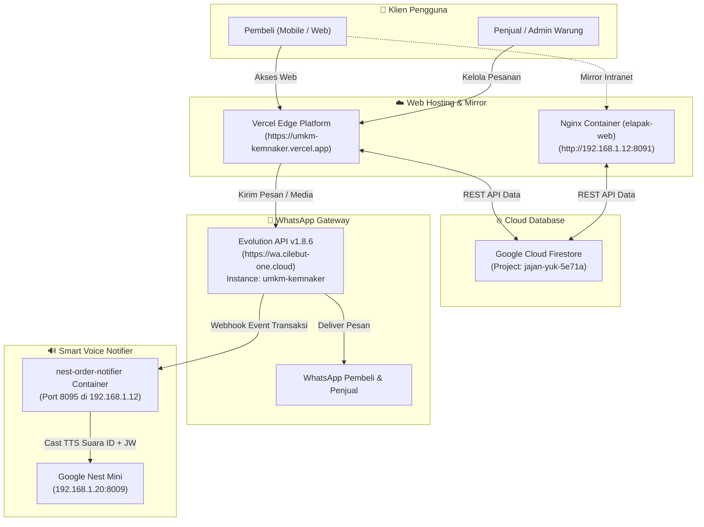
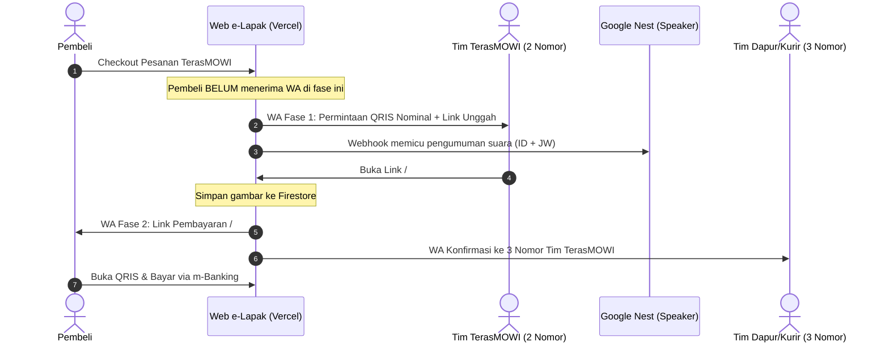

# 📖 DOKUMENTASI LENGKAP SISTEM e-LAPAK KEMNAKER (YUUK JAJAN)

> **Versi Dokumentasi**: 2.0 (Oktober 2026)  
> **Aplikasi**: Platform Marketplace Digital UMKM Pegawai Kementerian Ketenagakerjaan RI  
> **Production URL**: [https://umkm-kemnaker.vercel.app](https://umkm-kemnaker.vercel.app)  
> **Local Server Mirror**: [http://192.168.1.12:8091](http://192.168.1.12:8091)  
> **Repository GitHub**: [https://github.com/deamok/umkm-kemnaker](https://github.com/deamok/umkm-kemnaker)

---

## 📑 DAFTAR ISI
1. [Ringkasan Sistem & Arsitektur Global](#1-ringkasan-sistem--arsitektur-global)
2. [Peta Struktur Direktori & Berkas](#2-peta-struktur-direktori--berkas)
3. [Alur Transaksi & Bisnis (Workflow)](#3-alur-transaksi--bisnis-workflow)
   - [A. Alur Warung Standar (Non-TerasMOWI)](#a-alur-warung-standar-non-terasmowi)
   - [B. Alur Khusus Warung TerasMOWI (2-Fase QRIS Dinamis)](#b-alur-khusus-warung-terasmowi-2-fase-qris-dinamis)
4. [Integrasi WhatsApp (Evolution API)](#4-integrasi-whatsapp-evolution-api)
5. [Layanan Notifikasi Suara Google Nest (`nest-order-notifier`)](#5-layanan-notifikasi-suara-google-nest-nest-order-notifier)
6. [Konfigurasi Server Docker (`192.168.1.12`)](#6-konfigurasi-server-docker-192168112)
7. [Panduan Operasional & Perkakas Script](#7-panduan-operasional--perkakas-script)
   - [Jalankan Lokal](#a-menjalankan-server-lokal)
   - [Deploy ke Server Docker](#b-deploy-ke-server-docker)
   - [Backup Sistem Penuh](#c-backup-sistem-penuh)
   - [Restore Sistem](#d-restore-sistem)
8. [Daftar Kontak, Nomor Telepon, & Kredensial](#8-daftar-kontak-nomor-telepon--kredensial)

---

## 1. Ringkasan Sistem & Arsitektur Global

e-Lapak Kemnaker adalah aplikasi web modern berbasis **Single Page Application (SPA)** yang dirancang ringan, cepat, tanpa dependensi build-step berat (zero-bundler SPA). Aplikasi ini melayani transaksi internal pegawai Kemnaker dengan kemudahan pemesanan, pencatatan otomatis, notifikasi WhatsApp real-time, dan pengumuman suara via Google Nest.



---

## 2. Peta Struktur Direktori & Berkas

Berikut struktur repositori terkini yang telah dibuat kompak, seragam, dan efisien:

```text
c:\AntiGravity.project\e-lapak\
├── .dockerignore                # Filter berkas build Docker
├── .gitignore                   # Filter repositori Git
├── DOKUMENTASI.md               # Dokumentasi teknis & operasional ini
├── Dockerfile                   # Nginx Alpine container untuk intranet mirror
├── README.md                    # Ringkasan cepat proyek
├── backup.bat                   # Launcher batch untuk backup
├── backup.py                    # Script full backup (Firestore + Code + WA Session)
├── deploy.bat                   # Launcher batch untuk deployment
├── deploy.py                    # Script deploy cerdas (Git Pull + Docker Rebuild)
├── docker-compose.yml           # Konfigurasi container elapak-web (Port 8091)
├── index.html                   # Entry point utama SPA
├── jalankan_lokal.bat           # Launcher server lokal port 3000
├── nginx.conf                   # Konfigurasi Nginx, SPA routing & WA proxy
├── restore.bat                  # Launcher batch untuk restore
├── restore.py                   # Script pemulihan penuh
├── vercel.json                  # Konfigurasi rewrites Vercel Edge
│
├── app/                         # Source code JavaScript aplikasi (ES Modules)
│   ├── app.js                   # Inisialisasi router, toast, navbar, & footer
│   ├── auth.js                  # Manajemen session & autentikasi pengguna
│   ├── firebase-init.js         # REST client Firestore helper
│   ├── lucide.min.js            # Library icon SVG lokal
│   ├── router.js                # Hash router SPA (/#/path)
│   ├── store.js                 # State management & interaksi data Firestore
│   ├── utils.js                 # Format rupiah, date, modal helper
│   │
│   ├── components/              # Komponen modular UI
│   │   ├── footer.js            # Footer navigasi mobile & desktop
│   │   ├── modal.js             # Modal generator serbaguna
│   │   ├── navbar.js            # Navigasi atas, status login, & keranjang
│   │   ├── productCard.js       # Kartu item menu produk
│   │   ├── receiptModal.js      # Modal nota cetak resmi Kemnaker
│   │   └── toast.js             # Notifikasi pop-up toast
│   │
│   └── pages/                   # Modul halaman SPA
│       ├── bayarQris.js         # [Publik] Halaman scan QRIS nominal oleh pembeli
│       ├── cart.js              # Keranjang belanja & pemilihan kurir
│       ├── chatRoom.js          # Ruang obrolan langsung pembeli-penjual
│       ├── chats.js             # Daftar pesan masuk
│       ├── checkout.js          # Halaman konfirmasi pesanan & alur 2-fase TerasMOWI
│       ├── dashboard.js         # Panel admin penjual (kelola menu, status pesanan)
│       ├── home.js              # Beranda (daftar warung & promo)
│       ├── lapak.js             # Halaman etalase warung tertentu
│       ├── login.js             # Masuk akun pembeli/penjual
│       ├── orders.js            # Riwayat pesanan pembeli
│       ├── productDetail.js     # Detail produk & pemilihan porsi/varian
│       ├── products.js          # Daftar pencarian produk menyeluruh
│       ├── profile.js           # Kelola profil, alamat kirim, nomor HP
│       ├── register.js          # Pendaftaran akun baru
│       └── uploadQris.js        # [Penjual] Halaman unggah foto QRIS nominal
│
├── css/                         # File penataan gaya (Modular CSS)
│   ├── base.css                 # Reset dasar, tipografi Inter/Outfit
│   ├── components.css           # Styling tombol, badge, card, form, modal
│   ├── pages.css                # Styling spesifik layout halaman
│   └── variables.css            # Variabel warna tema, elevasi, radius
│
└── img/                         # Seluruh aset gambar produk, logo & favicon
    ├── cart-icon.svg            # Favicon SVG keranjang
    ├── favicon.png              # Favicon PNG
    ├── kemnaker_logo.png        # Logo resmi Kementerian Ketenagakerjaan
    ├── qris-terasmowi.jpg       # QRIS Statis dasar TerasMOWI
    └── [foto produk *.jpg]      # Foto produk donat, roti, kopi, dll.
```

---

## 3. Alur Transaksi & Bisnis (Workflow)

### A. Alur Warung Standar (Non-TerasMOWI)
1. Pembeli memilih menu -> masuk ke Keranjang -> lanjut ke Checkout.
2. Saat menekan tombol **"Konfirmasi Pesanan"**:
   - Data pesanan dibuat di Firestore (koleksi `orders`) dengan status `pending` / `processing`.
   - Mengirim notifikasi WhatsApp ke nomor Penjual berisi rincian item, data pemesan, alamat antar (ruangan/lantai), dan metode bayar.
   - Mengirim notifikasi WhatsApp ringkas ke Pembeli sebagai bukti pesanan.

---

### B. Alur Khusus Warung TerasMOWI (2-Fase QRIS Dinamis)
Warung TerasMOWI menggunakan sistem **pembayaran QRIS nominal pas** yang digenerate manual dari m-Banking penjual (BNI Merchant), sehingga verifikasi dana masuk menjadi instan dan akurat.



#### Tahap 1: Saat Pembeli Menekan Tombol Pesan (Checkout)
* **Nomor Penjual yang Dihubungi**:
  1. `085781335527` (Triyatmoko)
  2. `6281289004462`
* **Format Pesan WA**: Ringkas dan fokus meminta QRIS nominal:
  ```text
  🔔 *PERMINTAAN QRIS NOMINAL (TerasMOWI)*
  ━━━━━━━━━━━━━━━━━━━━
  📋 *No. Pesanan:* SO.2026-10.0044
  👤 *Pembeli:* Suluh
  💰 *Total Bayar: Rp 60.000*
  ━━━━━━━━━━━━━━━━━━━━
  Silakan buat QRIS dengan nominal di atas, lalu kirimkan gambarnya melalui tautan berikut:
  👉 https://umkm-kemnaker.vercel.app/#/kirim-qris?orderId=SO.2026-10.0044
  ```
* **Pembeli**: **Tidak** menerima notifikasi WA pada tahap ini agar tidak bingung mencari kemana harus membayar.
* **Google Nest**: Otomatis bersuara mengumumkan ada pesanan baru masuk.

#### Tahap 2: Saat Penjual Mengunggah QRIS di Halaman `/#/kirim-qris`
1. Penjual membuka m-Banking, buat QRIS sebesar nominal tagihan pas, lalu tangkap layar (screenshot).
2. Membuka link dari WA, memilih foto QRIS, dan menekan **"Kirim QRIS ke Pembeli & Tim"**.
3. Sistem mengompresi gambar, menyimpannya ke dokumen Firestore (`qrisNominalImage`), lalu mengirimkan:
   - **Ke Pembeli (`buyerPhone`)**: Mengirimkan gambar QRIS via media WhatsApp dan tautan interaktif publik:
     `https://umkm-kemnaker.vercel.app/#/bayar-qris?orderId=SO.2026-10.0044`
   - **Ke 3 Nomor Tim TerasMOWI**:
     - `6285781335527`
     - `6281289004462`
     - `6289658107313`
     Memberitahukan bahwa QRIS telah diterima pembeli sehingga dapur dan kasir siap memantau mutasi rekening.

---

## 4. Integrasi WhatsApp (Evolution API)

Seluruh notifikasi WhatsApp ditenagai oleh **Evolution API v1.8.6** yang berjalan di server container.

* **URL Server**: `https://wa.cilebut-one.cloud`
* **Instance**: `umkm-kemnaker`
* **API Key**: `cilebut-ONE.server:2026`
* **Karakteristik Pengiriman**:
  - Format nomor HP otomatis distandardisasi ke awalan `62` (misal `0811...` menjadi `62811...`).
  - Menggunakan endpoint `/message/sendText/{instance}` untuk teks dan `/message/sendMedia/{instance}` untuk gambar/QRIS.
  - Terdapat jeda sekuensial **1.500 ms (1,5 detik)** antar pengiriman nomor guna mencegah tabrakan kunci enkripsi E2EE Baileys (*session key collision*).
  - Reverse proxy Nginx (`/wa-api/`) disediakan di server intranet agar Klien Web dapat terhindar dari pemblokiran CORS jika mengakses tanpa HTTPS langsung.

---

## 5. Layanan Notifikasi Suara Google Nest (`nest-order-notifier`)

Service ini bertindak sebagai asisten suara pintar yang membaca pengumuman saat ada pesanan masuk.

* **Lokasi di Server**: `/opt/nest-order-notifier`
* **Port Layanan**: `8095` (Host network mode)
* **Target Speaker**: Google Nest Mini di IP `192.168.1.20:8009`
* **Teknologi**: Python 3.10, `pychromecast`, Google Text-to-Speech (`gTTS`), Docker.

### Fitur Utama:
1. **Dwibahasa Berurutan**:
   - 🇮🇩 **Bahasa Indonesia**: *"Perhatian, ada pesanan baru masuk di umkm terasmowi dari [Nama], total [Nominal] rupiah."*
   - (Jeda 5 detik)
   - ☕ **Bahasa Jawa Krama**: *"Kawigatosan, wonten pesenan enggal mlebet wonten umkm terasmowi saking [Nama], sedaya [Nominal] rupiah."*
2. **Deduplikasi Cerdas (60 Detik)**:
   - Jika Evolution API mengirimkan beberapa event webhook untuk order ID yang sama (karena terkirim ke 2 pengelola), sistem hanya akan mengumumkan suara **1 kali saja** dalam jendela 60 detik.
3. **Pembersihan Otomatis Audio**:
   - File MP3 hasil generate TTS disimpan di `./static/` dan otomatis diputar ke Nest melalui HTTP. Berkas lama otomatis dirotasi dan dibatasi maksimal 20 berkas agar tidak memenuhi disk server.
4. **Endpoint Testing Cepat**:
   - `GET /health`: Cek kesehatan koneksi dan jumlah antrean suara.
   - `POST /test`: Memicu pengumuman suara simulasi (`{"buyer": "Nama", "total": "50.000"}`).

---

## 6. Konfigurasi Server Docker (`192.168.1.12`)

Daftar kontainer utama yang bertugas mendukung ekosistem e-Lapak:

| Nama Kontainer | Port Host | Fungsi | Lokasi Direktori |
|---|---|---|---|
| **`elapak-web`** | `8091:80` | Web Nginx SPA mirror (intranet Kemnaker) | `/home/deamok/e-umkm` |
| **`nest-order-notifier`** | `8095` (Host) | Webhook WhatsApp & Cast TTS ke Google Nest | `/opt/nest-order-notifier` |
| **`evolution-api`** | `8081:8081` | WhatsApp API Gateway Engine (Baileys) | `/home/deamok/evolution-api` |
| **`evolution-redis`** | `6379` | Cache session WhatsApp | - |
| **`evolution-mongo`** | `27017` | Database riwayat pesan WhatsApp | - |

> ⚠️ **Catatan Penting Port 8090 vs 8091**:  
> Port `8090` digunakan oleh service sistem lain (`mitv-remote`). Kontainer `elapak-web` telah dialokasikan secara permanen ke port **`8091`** untuk mencegah konflik port.

---

## 7. Panduan Operasional & Perkakas Script

Semua perkakas pemeliharaan telah dibuat dalam bentuk skrip Python terstandarisasi (`.py`) yang dilengkapi launcher klik-ganda Windows (`.bat`).

### A. Menjalankan Server Lokal
Cukup klik ganda **`jalankan_lokal.bat`** di laptop.
* Memulai HTTP server lokal di port `3000`.
* Otomatis membuka peramban ke `http://localhost:3000`.

### B. Deploy ke Server Docker
Jika ada pembaruan kode dan ingin memperbarui container di server lokal `192.168.1.12`:
* Klik ganda **`deploy.bat`** (atau jalankan `python deploy.py`).
* Skrip akan otomatis:
  1. Mendeteksi koneksi aktif (apakah sedang di jaringan kantor/LAN atau via ZeroTier).
  2. Login via SSH.
  3. Menjalankan `git fetch && git reset --hard origin/main` di server `/home/deamok/e-umkm` (sangat cepat & bersih).
  4. Menjalankan `docker compose up -d --build`.
  5. Menampilkan tabel status container yang baru berjalan.

### C. Backup Sistem Penuh
Untuk membuat arsip cadangan komprehensif:
* Klik ganda **`backup.bat`** (atau jalankan `python backup.py`).
* Komponen yang dicadangkan menjadi satu file ZIP:
  1. **Cloud Firestore**: Seluruh koleksi (`users`, `lapaks`, `products`, `orders`, `chats`) di-export ke format JSON.
  2. **Source Code**: Kode aplikasi dan seluruh aset gambar.
  3. **Sesi WhatsApp**: Menarik arsip Docker volume sesi WhatsApp (`evolution_instances` & `evolution_store`) langsung dari server.
* File output tersimpan di folder `backups/backup_YYYYMMDD_HHMMSS.zip`.

### D. Restore Sistem
Untuk memulihkan data jika terjadi kendala:
* Klik ganda **`restore.bat`** (atau jalankan `python restore.py`).
* Menampilkan daftar cadangan yang ada, dan Anda dapat memilih untuk merestore Database Firestore, Kode Web, maupun Sesi WhatsApp ke server.

---

## 8. Daftar Kontak, Nomor Telepon, & Kredensial

### A. Nomor WhatsApp Tim TerasMOWI
| Nama / Posisi | Nomor WhatsApp | Peran dalam Alur |
|---|---|---|
| **Triyatmoko** | `085781335527` (`6285781335527`) | Penerima Notif Fase 1 (Generate QRIS) & Notif Fase 2 |
| **Admin TerasMOWI 2** | `081289004462` (`6281289004462`) | Penerima Notif Fase 1 (Generate QRIS) & Notif Fase 2 |
| **Admin TerasMOWI 3** | `089658107313` (`6289658107313`) | Penerima Notif Fase 2 (Konfirmasi Pesanan Siap) |

### B. Konfigurasi Server Remote
* **Host LAN**: `192.168.1.12` (Port SSH: `22`)
* **Host ZeroTier**: `10.147.19.13`
* **User**: `deamok`
* **Password**: `sa123`
* **Google Nest Speaker**: `192.168.1.20` (Port Cast: `8009`)

---
*Dokumentasi ini dibuat secara otomatis dan komprehensif untuk memastikan kesinambungan pemeliharaan sistem e-Lapak Kemnaker.*
